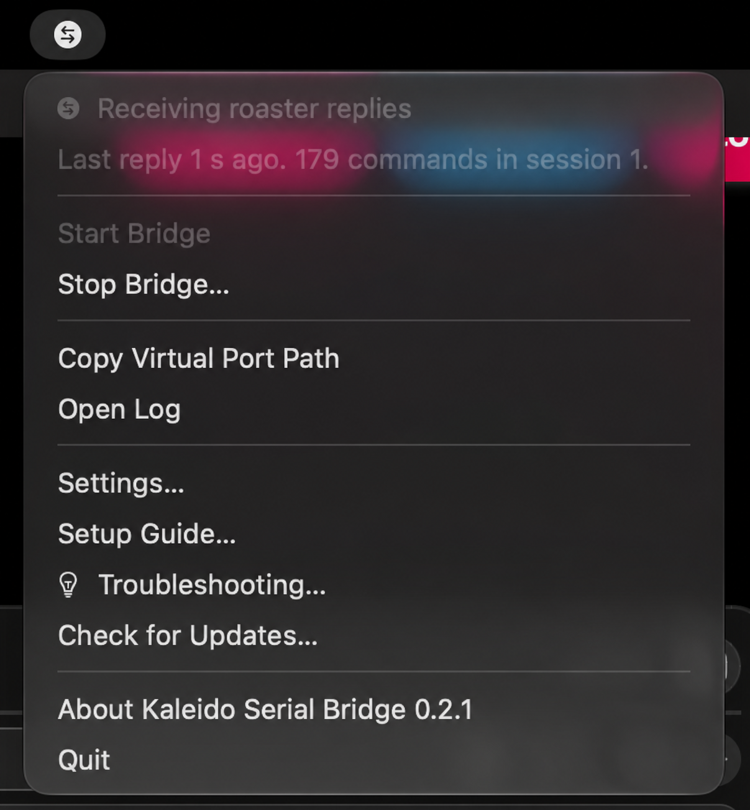

# Kaleido Serial Bridge

Kaleido Serial Bridge is an independent macOS menu bar utility designed to keep a Kaleido
roaster's Bluetooth serial port open while Artisan disconnects and reconnects through a virtual
serial port. It was developed to investigate a reconnect issue observed on one M2 Lite setup. It
is unaffiliated with Kaleido and Artisan.

```
Artisan  <-->  virtual port (~/.kaleido-bridge/cu.Roaster_bridge)  <-->  this app  <-->  roaster's Bluetooth port
               opened and closed by Artisan as often as it likes        opened once, kept open
```

## Read this first

- **It is an experiment, tested on one setup, with the roaster idle and the heater off.** See
  [Evidence](#evidence) for exactly what was and was not tested.
- **It does not fix macOS Bluetooth and does not prevent disconnects.** It avoids closing and
  reopening the roaster's serial port, which is where the issue showed on the tested setup.
- **It is not a safety device and does not make the roaster safer.** What the roaster does if
  Artisan crashes or the Bluetooth link is lost while it is heating has not been verified, with or
  without the bridge.
- **It is not suitable for unattended operation.** Stay with the roaster while it is hot.
- **The download is a pre-release.** A disk image for Apple silicon, signed with a Developer ID
  and notarized by Apple, is on the
  [Releases](https://github.com/JohnBThomas/kaleido-serial-bridge/releases) page. It was checked
  on the Mac that built it and nowhere else. See [Evidence](#evidence).

## Menu bar



## Install

1. Download the disk image, `KaleidoSerialBridge-<version>-arm64.dmg`, from the
   [Releases](https://github.com/JohnBThomas/kaleido-serial-bridge/releases) page.
2. Open it.
3. Drag **Kaleido Serial Bridge** into **Applications**, and open it from there.

It has no Dock icon and no window of its own; look for its symbol in the menu bar. A setup guide
opens the first time; see [Setup](#setup). It needs a Mac with Apple silicon and macOS 13 or later,
and nothing else installed.

To check the download, put `SHA256SUMS.txt` from the same page into the same folder and run
`shasum -a 256 -c SHA256SUMS.txt`.

## Background

On the tested setup (Apple silicon MacBook Pro, macOS 27.2, Artisan 5.0.0, Kaleido M2 Lite over
Bluetooth), Artisan showed temperatures on the first ON after a restart, and none after
**OFF → ON** or **quit → relaunch → ON**, until Bluetooth was reset. Others report the same in
[artisan#1705](https://github.com/artisan-roaster-scope/artisan/issues/1705).

In the failed reopen that was captured on that setup, Artisan had closed the roaster's serial port
in order and macOS had closed the Bluetooth connection. During the next open of the port, no new
RFCOMM attempt appeared in the macOS log: the port opened, Artisan's pings were accepted, and
nothing came back. The bridge is built on that observation: it opens the port once and does not
close it, so there is no second open.

## Evidence

Hardware results and simulator results are kept apart. Details, with timelines:
[docs/EVIDENCE.md](docs/EVIDENCE.md).

**The signed download** — the disk image of the 0.2.0 pre-release, signed with a Developer ID and
notarized by Apple. The app in it has the CDHash `a9a59f259cc3528af70e43abbed537cb544186b0`.

- Gatekeeper accepted the notarized disk image, and a quarantined copy of the app, on the Mac that
  built them. The notarization ticket is stapled to the disk image.
- On one Kaleido M2 Lite, idle, with the heater off, on the build Mac: the app opened at login,
  the bridge started by itself, live readings arrived, and they returned after **OFF → ON**
  through one open of the physical port. The logs confirm each of these.
- Pending: **⌘Q → relaunch → ON** with this build. The tester reports that readings returned; the
  logs show the quit but no relaunch.
- Not tested: installation on a second Mac, and a first launch without a network connection.

**On hardware** — one Kaleido M2 Lite, one Apple silicon MacBook Pro, macOS 27.2, Artisan 5.0.0,
roaster idle, heater off:

- The **Terminal prototype** (version 0.1.0 of the bridge) passed **OFF → ON** and
  **⌘Q → relaunch → ON**: temperatures returned both times, with one open of the physical port.
  The successful run started after a Mac restart. Four earlier starts that day got no replies,
  three of them directly after a reset of Bluetooth.
- The **packaged menu bar app**, 0.2.0, was run as two local ad hoc signed builds that differ in
  texts only. Each result belongs to the build it was obtained with.
  - Build with the CDHash `bab9676fa030389d71bddd6b3565767a7014e9d3`: it forwarded real
    temperature data, handled a clean Artisan detach, and kept the same physical serial port open
    for the next attach. The sequence the logs establish for it is **OFF → ON**, and only that. It
    did so twice, the second time after an 84-minute session. An earlier start of that build, the
    first after another restart of the Mac, did not lead to a connection.
  - Build with the CDHash `7630086f5c8316900d0bbec2ef9a310eb11cfe2b`, the later ad hoc test
    build, made from this source: the **first connection** after a start, **OFF → ON**,
    **⌘Q → relaunch → ON**, and the **app opening at login**. The tester saw each of these work,
    and the logs confirm each: replies returned every time, through one open of the physical port
    and one Bluetooth connection.

The bridge starting by itself was reported for the build `7630086f…` too, but the logs of that run
show the bridge being started from the menu, so it counts as verified for the signed build only.

**With a simulated roaster** — no hardware involved: 72 automated tests of the bridge, the status
logic and the app's menu, setup guide and alerts; a check that runs the packaged app by itself;
and a run of unmodified Artisan 5.0.0 source through the prototype bridge.

**Not verified:**

- other Kaleido models, other Macs and other macOS versions
- behavior during an Artisan crash or a loss of the Bluetooth link **while the roaster is heating**
- the Bluetooth link staying up for hours with no Artisan attached
- the signed download on a second Mac, and its first launch without a network connection

## Requirements

- A Mac with Apple silicon, macOS 13 or later (tested on macOS 27.2 only)
- A Kaleido roaster paired over Bluetooth and used with Artisan's **Kaleido → Serial** setup
- To build: Python 3.11 or later (3.14 was used)

## Build

```
git clone https://github.com/JohnBThomas/kaleido-serial-bridge.git
cd kaleido-serial-bridge
python3 -m venv ~/.venvs/kaleido-serial-bridge
source ~/.venvs/kaleido-serial-bridge/bin/activate
pip install -e ".[dev]"

python -m pytest          # the checks, against a simulated roaster
packaging/build.sh        # builds the app and a disk image into dist/
```

Keep the virtual environment outside folders synced by iCloud Drive.

The result, `dist/KaleidoSerialBridge-<version>-arm64.dmg`, contains a self-contained app (its own
Python, pyserial and PyObjC). It is signed ad hoc: it opens normally on the Mac that built it. On
another Mac, macOS refuses it until you allow it in **System Settings » Privacy & Security »
Open Anyway**. Signing and notarizing for distribution is described in
[docs/DISTRIBUTION.md](docs/DISTRIBUTION.md); that is how the disk image on the Releases page was
made.

To install your build: open the disk image, drag **Kaleido Serial Bridge** onto **Applications**
and open it from there. It has no Dock icon and no window of its own; look for its symbol in the
menu bar.

To run from source without building: `python -m kaleido_serial_bridge` (the app) or
`python -m kaleido_serial_bridge.cli /dev/cu.Roaster_SRSv6` (the bridge alone, in a terminal).

## Setup

The first time the app opens, a setup guide leads through five steps. It can be reopened from the
menu (**Setup Guide…**).

1. **Pair the roaster.** Switch it on and connect to it once in Bluetooth settings. If Artisan
   already reads the roaster over Bluetooth, it is paired.
2. **Choose the roaster's serial port.** Ports whose name looks like a Kaleido, such as
   `Roaster_SRSv6`, are listed first. You pick the exact port; the choice is remembered.
3. **Start the bridge.** Click OFF in Artisan first. After Start, the menu shows "Waiting for
   Bluetooth" for a while. In the one Terminal run where this was timed, macOS reported the
   roaster as connected about 13 seconds after the start.
4. **Point Artisan at the virtual port.** In Artisan open **Config » Port… » ET/BT » Comm Port**,
   paste the path the guide shows (there is a Copy button) and click OK. Leave the rest of the
   Kaleido serial setup as it is (57600, 8, N, 1). Then click ON.
5. **Keep two settings files**, to switch between the bridge and the direct connection:
   - with the Comm Port set to the virtual port: **Help » Save Settings…** → `artisan-bridge.aset`
   - set the Comm Port back to the roaster's own port: **Help » Save Settings…** → `artisan-direct.aset`
   - **Help » Load Settings…** switches between the two from then on.

### The menu bar symbol

| Shows | Means |
|---|---|
| Bridge stopped | The roaster's Bluetooth port is not open. |
| Waiting for Bluetooth | The port is open, but macOS has not reported the roaster as connected. |
| Waiting for Artisan | The port is open and nobody is using the virtual port. In Artisan, click ON. |
| Artisan attached, waiting for the first reply | Artisan has opened the virtual port; nothing has come back yet. |
| Receiving roaster replies | Replies of the roaster are being passed on to Artisan right now. |
| No replies from the roaster | Artisan is asking and the roaster does not answer. |
| Stopped after a failure | The Bluetooth port failed, or Artisan vanished mid-session. An alert says which. |

An open port is never shown as communication. Only replies that were actually passed on to
Artisan count.

The menu has **Start Bridge**, **Stop Bridge…**, **Copy Virtual Port Path**, **Open Log**,
**Settings…**, **Setup Guide…**, help, About and Quit. Stop and Quit ask first. If Artisan is
attached, the answer defaults to Cancel: stopping then takes the port away from Artisan before it
can tell the roaster that it is leaving. Click OFF in Artisan first.

### Settings

- **Roaster's serial port** — can be changed while the bridge is stopped.
- **Start the bridge when the app opens** — off by default. Starting opens the Bluetooth port, and
  that should happen when you intend it. Confirmed with the simulator, and on hardware
  with the signed build (see [Evidence](#evidence)).
- **Open the app at login** — off by default. It worked on hardware with one ad hoc build and
  with the signed build. It uses the login item service of macOS; the app then
  appears in **System Settings » General » Login Items**. This opens the app and nothing more: the
  bridge starts at login only if the option above is on as well.

### Using it

On the tested setup the sequence that worked was: restart the Mac, start the bridge once, wait for
"Waiting for Artisan", then use Artisan as usual. Four of the five starts that directly followed a
restart connected; one did not, and the next start after one more restart did. Stopping the
bridge closes the roaster's port. On that setup the opens of the port that followed got no
replies, including opens after a restart of the Bluetooth service or after turning Bluetooth off
and on.

## Manual recovery: no readings

The menu shows "Waiting for Bluetooth" for more than a minute, or "No replies from the roaster",
and Artisan shows no temperatures.

Most likely macOS did not connect the roaster for this open of its port. On the tested setup that
happened on opens after the port had been closed, by Artisan or by an earlier start of the bridge.
It also happened on first opens after a reset of Bluetooth, and once on the first open after a
restart of the Mac. Waiting did not help there, and neither did clicking ON again.

1. In Artisan, click OFF.
2. Stop the bridge.
3. Reset Bluetooth yourself. Restarting the Mac is the reset that helped on the tested setup, but
   not every time: four of the five starts that directly followed a restart connected, and the
   one that did not was followed by a connection after one more restart. Restarting the Bluetooth
   service in Terminal with `sudo pkill -x bluetoothd` was followed by a connection once, with
   Artisan connected directly, and by silent starts of the bridge twice. Turning Bluetooth off and
   on was followed by a silent start the one time it is in the logs.
4. Start the bridge and wait for "Waiting for Artisan". If the menu stays at "Waiting for
   Bluetooth" for more than a minute, stop the bridge and restart the Mac once more.
5. In Artisan, click ON.

No reset is known to bring the connection back every time. The app never resets Bluetooth and
never reopens the port on its own.

## Switching back to direct Bluetooth

1. In Artisan, click OFF.
2. Stop the bridge (or quit the app).
3. In Artisan, load `artisan-direct.aset`, or set **Config » Port… » ET/BT » Comm Port** back to
   the roaster's own port, for example `/dev/cu.Roaster_SRSv6`.
4. Click ON. Since the port was just closed, the next open may again get no replies; if so, reset
   Bluetooth as above.

## What it does and does not do

- It forwards Artisan's commands to the roaster and the roaster's replies to Artisan without
  changing their content, including Artisan's own safety commands (`SC AR` when Artisan connects,
  `CL AR` when it disconnects). A command is held until its line is complete and is then sent
  whole, in order, at most once. Replies that arrive while no Artisan is listening are discarded.
- It never sends anything of its own to the roaster. It never answers Artisan for the roaster,
  never repeats a command, and never keeps the roaster's safety guard alive when Artisan is gone.
- It opens the roaster's port once per start and never reopens it. It never changes Bluetooth
  settings and never resets Bluetooth.
- One Artisan at a time: a second one gets "Could not exclusively lock port".
- If Artisan **crashes or is force quit while connected**, the bridge closes the roaster's port
  and stops, so that the roaster sees the link drop as it would without the bridge. An alert says
  so. This has been tested with the simulator only.
- If the **Bluetooth port reports an error**, the bridge stops, takes the virtual port away so
  that Artisan reports the disconnect, and shows an alert. This has been tested with the simulator
  only; how a real lost link shows up on the port is not known.

What the roaster gets to see in each case, and what is unknown: [docs/SAFETY.md](docs/SAFETY.md).

## Uninstall

1. If you had turned on **Open the app at login**, turn it off in Settings.
2. Quit the app from its menu.
3. Move **Kaleido Serial Bridge** from Applications to the Trash.
4. Delete the folder `.kaleido-bridge` in your home folder (Finder: **Go » Go to Folder…** and
   enter `~/.kaleido-bridge`). It holds the settings, the log and the virtual port.
5. In Artisan, set the Comm Port back to the roaster's own port.

Nothing else is installed.

## Files it uses

| | |
|---|---|
| `~/.kaleido-bridge/cu.Roaster_bridge` | the virtual port (exists while the bridge runs) |
| `~/.kaleido-bridge/settings.json` | the chosen port and the two options |
| `~/.kaleido-bridge/bridge.log` | the log (**Open Log**); kept below 4 MB |
| `~/.kaleido-bridge/status.json` | the current status in machine readable form (exists while the app runs) |

`KALEIDO_BRIDGE_HOME=/some/folder` makes the app use another folder.

## For developers

```
python -m pytest                              # 72 tests against a simulated roaster, about 30 s
ruff check . && mypy && codespell
packaging/build.sh
python tests/packaged_app_check.py "$TMPDIR/kaleido-serial-bridge-build/dist/Kaleido Serial Bridge.app"
```

| | |
|---|---|
| `src/kaleido_serial_bridge/engine.py` | the bridge itself |
| `src/kaleido_serial_bridge/controller.py` | runs the engine for the app and derives the status |
| `src/kaleido_serial_bridge/app.py`, `ui.py`, `menu.py`, `guide.py` | menu bar item, windows, texts |
| `src/kaleido_serial_bridge/cli.py` | command line entry |
| `tools/sim_roaster.py` | a simulated roaster on a pseudo terminal |
| `tools/make_bridge_aset.py` | copies an Artisan `.aset`, changing only the Comm Port |
| `tests/` | engine, controller and app tests; the check of the packaged app; an end-to-end run with Artisan itself |
| `packaging/` | PyInstaller spec, icon, build and notarization scripts |

## License and attribution

[MIT](LICENSE). The code in this repository was written for this project; it contains no code from
Artisan or from Kaleido. Components that end up inside a built app are listed in
[THIRD_PARTY_NOTICES.md](THIRD_PARTY_NOTICES.md).

"Kaleido" and "Artisan" are names of their respective owners and are used here only to say what
the utility works with.
