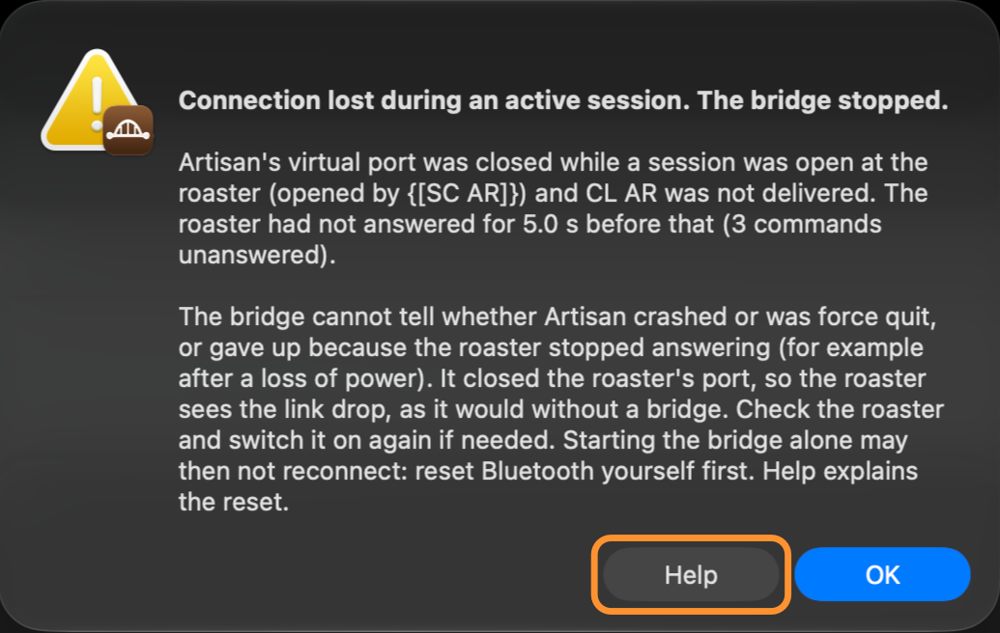
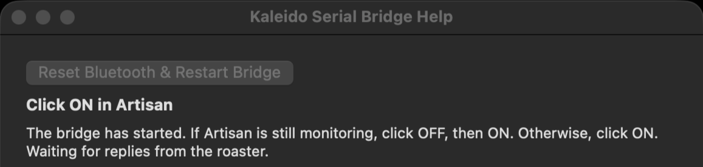
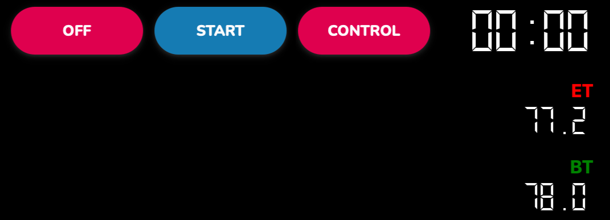

# Troubleshooting: when the connection to the roaster is lost

This guide walks through what to do when Kaleido Serial Bridge stops with **"Connection lost
during an active session"**, for example after the roaster was unplugged or lost power. It shows
the released app, version 0.2.1.

Keep the roaster idle with its heater off while you follow these steps, and stay with it. The
bridge is not a safety device.

If the menu instead stays at "Waiting for Bluetooth" after you start the bridge, see
[Manual recovery: no readings](../README.md#manual-recovery-no-readings) in the README.

## 1. Connection lost

*The alert after the roaster lost power. Click **Help**.*

The bridge has stopped and closed the roaster's port; Artisan stays open and shows no readings.
The bridge cannot tell whether Artisan crashed or gave up because the roaster stopped answering, so
the alert says whether the roaster had stopped answering first.

1. Switch the roaster on again if it lost power, and let it become idle. Leave the heater off.
2. Click **Help**. This opens the Troubleshooting window. You can also open it at any time with
   **Troubleshooting…** in the bridge's menu.

## 2. Reset Bluetooth & Restart Bridge

*Click **Reset Bluetooth & Restart Bridge** at the top of the Troubleshooting window. This
confirmation appears first.*

Before you click **Reset Bluetooth**, check that:

- the roaster is **switched on**,
- it is **idle**, and
- its **heater is off**.

What happens next:

- macOS asks you to authorize the reset. You can use **Touch ID** when your Mac has it, or enter
  an administrator password.
- **Every Bluetooth device of this Mac disconnects for a few seconds**: keyboards, mice, trackpads
  and headphones included. They usually reconnect by themselves.
- The bridge restarts Bluetooth, waits for the roaster's serial port, and starts once.

One click makes one attempt. The button works only while the bridge is stopped. If a step fails,
the window names it and shows the manual steps.

## 3. Readings restored

*When the bridge has started, the window asks you to turn Artisan's monitoring on.*

In Artisan:

- **If Artisan is still monitoring**, its first button reads **OFF** and the temperatures show
  `UU` or no longer change. Click **OFF**, then **ON**.
- **Otherwise** the button reads **ON**: click **ON**.

*Live ET and BT in Artisan after the recovery.*

The Troubleshooting window shows **Readings are back** only once replies from the roaster actually
arrive through the bridge. If you open the window after another connection loss, it does not show
an earlier "Readings are back".

## If it does not help

- Read the step the window names, and follow the manual steps it shows.
- A restart of the Mac is the reset that helped most often on the tested Mac. No reset is known to
  bring the connection back every time.
- Every recovery step is written to the log: **Open Log** in the bridge's menu.

The recovery was tested on one Kaleido M2 Lite, idle, with the heater off. See
[EVIDENCE.md](EVIDENCE.md) for what was tested and how.
